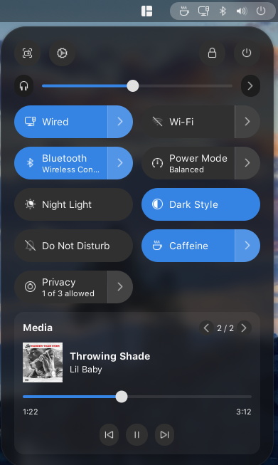

# Quick Settings NG

Quick Settings NG extends GNOME Shell 51 Quick Settings with media controls, privacy controls, per-application volume mixing, layout options, and focused interface refinements.

It integrates with the existing GNOME Quick Settings panel instead of replacing it.


<p align="center">
  
</p>

## Features

### Media

A full MPRIS media card integrated into Quick Settings.

- Album artwork
- Track title, artist, and album metadata
- Previous, play/pause, and next controls
- Live playback position
- Seek support
- Multiple MPRIS players
- Player navigation
- Exclusive playback switching between players
- Automatic hide when no supported player is available

The media controls use regular GNOME Shell widgets and avoid the stage-grab gesture implementation used by older Quick Settings extensions.

### Privacy

Quick access to GNOME privacy controls for:

- Location
- Camera
- Microphone

Privacy items can be displayed individually or as a grouped control.

### Application Volume

Per-application audio controls are integrated directly into GNOME's existing volume menu.

When applications expose active audio streams, the volume menu gains an `Application Volume` section with:

- Per-application volume sliders
- Per-application mute controls
- Application icons and names

No second master-volume control is added.

When no application streams are present, the section is hidden.

### Compact Layout

Optional reduced spacing for the Quick Settings panel.

### Menu Effects

Optional Quick Settings opening animation.

GNOME's global animation preference is respected.

### Preferences

A native libadwaita preferences window provides runtime configuration for the extension features.

## Requirements

- GNOME Shell 51

Extension UUID:

```text
quick-settings-ng@davidecelentano.github.io
```

## Installation

### GNOME Extensions

Quick Settings NG is distributed through the GNOME Extensions ecosystem.

Use GNOME Extensions or a compatible extension manager to install and manage the extension for supported GNOME Shell versions.

### GitHub Releases

Release packages are also available from:

https://github.com/davidecelentano/quick-settings-ng/releases

Install a downloaded release with:

```bash
gnome-extensions install --force quick-settings-ng@davidecelentano.github.io.shell-extension.zip
gnome-extensions enable quick-settings-ng@davidecelentano.github.io
```

Open the preferences window with:

```bash
gnome-extensions prefs quick-settings-ng@davidecelentano.github.io
```

When replacing an already loaded build, GNOME Shell may require a logout/login before loading all modules from the new version.

## Build

Clone the repository:

```bash
git clone https://github.com/davidecelentano/quick-settings-ng.git
cd quick-settings-ng
```

Install development dependencies:

```bash
npm ci
```

Run the complete validation and packaging pipeline:

```bash
npm run check
```

The resulting extension package is written to:

```text
build/quick-settings-ng@davidecelentano.github.io.shell-extension.zip
```

## Development Commands

TypeScript validation:

```bash
npm run typecheck
```

MPRIS model and player tests:

```bash
npm run test:mpris
```

GNOME Shell UI test:

```bash
npm run test:ui
```

Source integration audit:

```bash
npm run audit:source
```

Build only:

```bash
npm run build
```

Package:

```bash
npm run pack
```

## Architecture

Quick Settings NG is split into independent features with explicit lifecycle ownership.

```text
src/
├── compat/
│   └── GNOME Shell integration bridges
├── core/
│   ├── feature lifecycle
│   ├── settings
│   ├── Quick Settings host integration
│   └── ordering
├── features/
│   ├── layout/
│   ├── media/
│   ├── menu-effects/
│   ├── privacy/
│   └── volume-mixer/
├── extension.ts
└── prefs.ts

schemas/
styles/
tools/
docs/
```

The extension keeps GNOME-specific integration points narrow and separates feature lifetime from Shell integration.

The volume mixer uses a dedicated GNOME 51 integration bridge to attach application streams to the stock output-volume menu.

## Package Contents

A release package contains only runtime files required by GNOME Shell:

```text
extension.js
metadata.json
prefs.js
stylesheet.css
LICENSE
UPSTREAM.md

compat/
core/
features/
schemas/
```

The GSettings XML schema is included in the package. Precompiled `gschemas.compiled` files are not distributed.

## Documentation

Additional technical documentation is available in:

- [Architecture](docs/ARCHITECTURE.md)
- [Development](docs/DEVELOPMENT.md)
- [Source audit](docs/AUDIT.md)
- [Upstream provenance](docs/UPSTREAM.md)

## Upstream

Quick Settings NG incorporates ideas and selected implementation work derived from:

- [Quick Settings Tweaks](https://github.com/jstockdale/quick-settings-tweaks)
- [Privacy Menu Extension](https://github.com/stuarthayhurst/privacy-menu-extension)

Ported and adapted code is documented in [docs/UPSTREAM.md](docs/UPSTREAM.md).

## License

Quick Settings NG is licensed under the GNU General Public License v3.0 only.

See [LICENSE](LICENSE).
